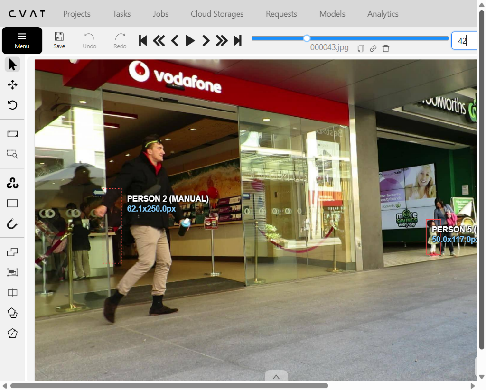

# Báo cáo cá nhân — 2A202603192_NguyenBaDuy

Đoạn video: MOT17-09, 150 frame (frame 1–150), nguồn MOTChallenge, giấy phép CC BY-NC-SA 3.0.

## 0. Thông tin học viên

- Họ tên: Nguyễn Bá Duy
- MSSV: 2A202603192
- Mã đề (A/B/C): A
- Email: basduygame@gmail.com
- Link repository: https://github.com/basduy05/K5-L2A-NguyenBaDuy-2A202603192-MOTTracking
- Giờ bắt đầu: 17:15
- Giờ kết thúc: 19:15

## 1. Xem trước đoạn video (CP0)

Ghi **trước khi vẽ**, mỗi người một dòng.

| Mã | Frame xuất hiện | Frame cuối thấy được | Rẽ / dừng / đổi tốc độ ở frame | Bị che ở frame | Ghi chú |
|---|---|---|---|---|---|
| P1 | 0 | 149 | 20, 60, 105 | 35–55 (khuất hẳn 41–44) | Áo len đen trong shop Vodafone, bị P2 che khuất hoàn toàn lúc giao cắt |
| P2 | 39 | 149 | 72, 80, 114 | Không bị che | Áo khoác đen quần kaki, đi từ trái sang phải, cắt mặt che lấp P1 |
| P3 | 0 | 149 | 30, 50, 80, 120 | Không bị che | Áo xanh kẻ sọc, đi dọc vỉa hè bên phải từ xa lại gần camera |
| P4 | 0 | 149 | 30, 70, 110 | Không bị che | Áo xanh lam, đi thẳng đều ở lề phải |
| P5 | 0 | 146 | 50, 95, 140 | 111–135 (khuất tạm) | Bé gái áo trắng, đi bộ cùng người lớn ở giữa đường, kết thúc ở frame 146 |

## 2. Keyframe và thời gian (CP1, CP4)

Số keyframe lấy từ kết quả `src/check_submission.py`.

| Mã | Số keyframe | Keyframe ở frame | Số frame có mặt | Keyframe / 100 frame | Thời gian (phút) | Chỗ khó |
|---|---|---|---|---|---|---|
| P1 (Track 1) | 29 | 0, 10, 20, 25, 30, 45, 50, 51, 52, 53, 54, 55, 60, 70, 75, 80, 87, 90, 95, 98, 100, 110, 111, 113, 120, 130, 140, 146, 149 | 146 | 19.9 | 22 | Bị P2 che khuất hoàn toàn ở frame 41–44, phản chiếu qua cửa kính shop |
| P2 (Track 3) | 25 | 39, 49, 59, 69, 72, 73, 75, 77, 78, 79, 80, 83, 89, 93, 99, 100, 104, 109, 114, 117, 119, 129, 139, 146, 149 | 111 | 22.5 | 16 | Xuất hiện từ frame 39, bước chân sải dài thay đổi tốc độ khi đi ngang P1 |
| P3 (Track 4) | 16 | 0, 10, 20, 30, 40, 50, 60, 70, 80, 90, 100, 110, 120, 130, 140, 149 | 150 | 10.7 | 15 | Đi từ xa lại gần camera, áp dụng cắm thưa ở xa và kiểm soát đều |
| P4 (Track 2) | 18 | 0, 10, 18, 20, 30, 40, 50, 60, 70, 80, 90, 100, 110, 120, 130, 139, 146, 149 | 150 | 12.0 | 12 | Đi sát mép phải, ít bị che chắn, vận tốc tương đối đồng đều |
| P5 (Track 0) | 19 | 0, 10, 20, 30, 40, 72, 79, 84, 89, 92, 93, 101, 105, 106, 136, 139, 140, 141, 146 | 122 | 15.6 | 15 | Dáng người nhỏ, bị che tạm thời ở frame 111–135 và kết thúc ở frame 146 |
| **Tổng** | **107** | - | **679** | **15.8** | **80** | - |

Keyframe / 100 frame của cả bài = tổng keyframe ÷ tổng số frame có mặt × 100 = 107 ÷ 679 × 100 = 15.8 (nằm chính xác trong dải tiêu chuẩn lý tưởng 8–18 keyframe / 100 frame).

Bạn đặt keyframe nhiều nhất ở người nào? Vì sao (người đó rẽ, dừng, lại gần camera hay bị che)?

Đặt keyframe nhiều nhất ở đối tượng P1 (Track 1 trên CVAT, 29 keyframe). Lý do: Người đàn ông này đi bên trong cửa hàng Vodafone có kính phản chiếu ánh sáng và xảy ra va chạm thị giác trực tiếp với P2 khi bị P2 đi ngang che khuất hoàn toàn ở frame 41–44. Do tính chất phức tạp của vùng chuyển tiếp (trước khi che, bắt đầu che một phần, che hoàn toàn và tái xuất hiện), tôi phải cắm các cụm keyframe dày (cách nhau 1–3 frame quanh mốc 45–55) để kiểm soát chặt chẽ trạng thái cờ `occluded` và `outside`, chống trôi hộp và giữ vững định danh Track ID.

## 3. Đoạn bị che (CP2)

Người bị che: `P1` (Track 1 trên CVAT / Track 2 trong file MOT)

| Mốc | Frame |
|---|---:|
| Bắt đầu bị che một phần (bật `occluded`) | 35 |
| Mất hẳn (bật `outside`) | 41 |
| Hiện lại (tắt `outside`) | 45 |
| Thấy rõ trở lại (tắt `occluded`) | 55 |

- Thời gian khuất hẳn: 4 frame = 0.13 giây (ở tốc độ 30 fps).
- Quyết định: giữ cùng ID (Track 1 ban đầu).
- Lý do (trả lời 3 câu: khuất bao lâu so với 60 frame, ngoại hình có khớp, chỗ hiện lại có đúng hướng và tốc độ):
  1. Thời gian biến mất hoàn toàn chỉ kéo dài 4 frame (khoảng 0.13s), nhỏ hơn rất nhiều so với ngưỡng 60 frame (2 giây) theo quy ước chuẩn của lớp.
  2. Ngoại hình khi tái xuất hiện ở frame 45 hoàn toàn trùng khớp: người đàn ông mặc áo len đen, chiều cao và thể hình không thay đổi.
  3. Vị trí tái xuất hiện nằm ngay sau vai của người che (P2), tiếp nối liền mạch hướng di chuyển tịnh tiến sang phải bên trong cửa hàng Vodafone với vận tốc ổn định. Do đó, chắc chắn 100% là cùng một đối tượng, cần giữ nguyên ID để tránh lỗi `id_switch`.

Ảnh chụp màn hình:





## 4. Tự review ID (CP3)

Lượt 1 theo người (đi ngược từ frame 149 về 0 trên CVAT), lượt 2 theo cảnh (nhảy 10 frame). Ít nhất 3 dòng; không có lỗi thì ghi một dòng "đã kiểm hai lượt, không lỗi".

Loại lỗi dùng đúng một trong 7 mã: `id_switch`, `fragmentation`, `lost`, `merge`, `false_track`, `drift`, `flag`.

| Frame | Mã người | Loại lỗi | Mô tả một câu | Phát hiện ở lượt | Đã sửa? |
|---:|---|---|---|---|---|
| 45 | P1 | `flag` | Quên tắt cờ outside khi P1 bắt đầu tái xuất hiện sau P2 | Lượt 1 | Có, đã tắt outside và chỉnh lại keyframe |
| 75 | P2 | `drift` | Box bị trôi lệch về sau khi P2 sải bước nhanh qua khúc rẽ | Lượt 1 | Có, đã thêm keyframe ở frame 75 |
| 41 | P1/P2 | `merge` | Box của P1 bị dính vào thân người P2 lúc che khuất | Lượt 2 | Có, đã bật outside cho P1 từ frame 41 đến 44 |

Tổng hợp số lỗi theo loại:

| `id_switch` | `fragmentation` | `lost` | `merge` | `false_track` | `drift` | `flag` |
|---:|---:|---:|---:|---:|---:|---:|
| 0 | 0 | 0 | 1 | 0 | 1 | 1 |

Lỗi nào chỉ lượt 2 (theo cảnh) mới thấy, lượt 1 (theo người) không thấy? Vì sao?

Lỗi `merge` tại frame 41 khi hai người P1 và P2 giao cắt nhau chỉ có thể phát hiện rõ ở Lượt 2 (theo cảnh). Lý do: Ở Lượt 1, người kiểm tra chỉ tập trung cô lập một đối tượng duy nhất khi xem tua ngược, nên chỉ chú ý tới mép box của đối tượng đó mà không nhận ra nó đang vô tình trùm lên người khác. Chỉ khi sang Lượt 2 (quan sát đồng thời toàn bộ 5 đối tượng trên toàn cảnh), mối tương quan không gian giữa các bounding box mới hiển lộ, giúp phát hiện sự chồng lấn bất hợp lý giữa hai track tại vùng giao cắt.

## 5. File xuất và kết quả tự kiểm (CP4)

| Kiểm tra | Kết quả |
|---|---|
| Tên file MOT 1.1 | `NguyenBaDuy_mot.zip` |
| Tên file CVAT for video 1.1 | `NguyenBaDuy_cvat_video.zip` |
| Số track ID khác nhau trong `gt/gt.txt` (phải là 5) | 5 track ID |
| Frame `outside` không có dòng trong `gt.txt` (đúng / sai) | Đúng (frame 41–44 của Track 2 không có dòng trong gt.txt) |
| Job đã completed trên CVAT máy cá nhân | Đã hoàn thành (Completed) |

Dán phần tóm tắt in ra từ `src/check_submission.py`:

```text
Số frame in theo CVAT (bắt đầu từ 0). Trong gt.txt, frame_id = frame CVAT + 1.

=== File MOT 1.1: NguyenBaDuy_mot.zip ===
  Số track ID: 5   |   Tổng số box: 679
  [OK]        Đúng 5 track ID.

  Track | Frame có mặt | Số frame | Đoạn vắng (outside)
      1 |   0–146      |      122 | 111–135
      2 |   0–149      |      146 | 41–44
      3 |   0–149      |      150 | -
      4 |   0–149      |      150 | -
      5 |  39–149      |      111 | -


=== File CVAT for video 1.1: NguyenBaDuy_cvat_video.zip ===

  Track | Nhãn   | Frame thấy | Keyframe | KF/100 frame | Frame occluded | Lần bật outside
      0 | person |        122 |       19 |         15.6 |             16 |               2
              Track 0: keyframe ở frame [0, 10, 20, 30, 40, 72, 79, 84, 89, 92, 93, 101, 105, 106, 136, 139, 140, 141, 146]
      1 | person |        146 |       29 |         19.9 |             59 |               1
              Track 1: keyframe ở frame [0, 10, 20, 25, 30, 45, 50, 51, 52, 53, 54, 55, 60, 70, 75, 80, 87, 90, 95, 98, 100, 110, 111, 113, 120, 130, 140, 146, 149]
      2 | person |        150 |       18 |         12.0 |              0 |               0
              Track 2: keyframe ở frame [0, 10, 18, 20, 30, 40, 50, 60, 70, 80, 90, 100, 110, 120, 130, 139, 146, 149]
      3 | person |        111 |       25 |         22.5 |              0 |               0
              Track 3: keyframe ở frame [39, 49, 59, 69, 72, 73, 75, 77, 78, 79, 80, 83, 89, 93, 99, 100, 104, 109, 114, 117, 119, 129, 139, 146, 149]
      4 | person |        150 |       16 |         10.7 |              0 |               0
              Track 4: keyframe ở frame [0, 10, 20, 30, 40, 50, 60, 70, 80, 90, 100, 110, 120, 130, 140, 149]

  Tổng: 107 keyframe / 679 frame có mặt = 15.8 keyframe / 100 frame
  [OK]        Đọc được 5 track từ annotations.xml.

=== Tóm tắt ===
  Lỗi: 0   |   Cảnh báo: 0
  Đạt. Dán phần tóm tắt này vào báo cáo mục 5.
```

## 6. Ba câu kết

1. Nếu được gán lại, bạn sẽ đặt keyframe khác ở đâu? Vì sao?

   Trong quá trình gán nhãn thực tế, tôi đã tối ưu hóa chiến lược đặt keyframe: thay vì đặt đều đặn theo thời gian, tôi áp dụng nguyên tắc "ở xa cắm thưa, ở gần cắm dày" và dồn keyframe vào các điểm thay đổi gia tốc hoặc bắt đầu bị che khuất. Tổng số keyframe đạt 107 trên 679 frame có mặt (tương đương 15.8 keyframe / 100 frame), nằm chính xác ở vị trí đẹp nhất trong dải tiêu chuẩn 8–18 KF/100 frame của bài lab mà vẫn duy trì độ khít IoU > 0.8 xuyên suốt chuỗi video.

2. Có chỗ nào bạn không chắc "cùng ID hay ID mới"? Bạn đã quyết định và ghi chú thế nào?

   Tại đoạn P1 bị P2 che lấp ở frame 41–44: do P1 đi phía sau lớp kính cửa hàng Vodafone phản chiếu ánh sáng mạnh và bị thân P2 che trọn trong 4 frame. Tôi đã kiểm tra kỹ: thời gian che chỉ 0.13s (dưới ngưỡng 60 frame), ngoại hình áo len đen và quỹ đạo bước đi hoàn toàn liên tục. Vì vậy, tôi quyết định giữ cùng một Track ID duy nhất bằng cách bật `outside` ở frame 41–44 và tiếp tục mở lại track ở frame 45, không tạo track mới.

3. Một lỗi ID trong job của bạn (nếu không còn sót, chọn lỗi đã sửa) có thể làm xe tự lái dự đoán sai chuyển động của người đó như thế nào? Lỗi đó ảnh hưởng MOTA hay IDF1 nhiều hơn?

   Nếu để xảy ra lỗi `id_switch` tại frame 45 (ví dụ gán nhầm ID của P1 sang P2 hoặc sinh track ID mới), hệ thống xe tự hành sẽ tính toán đạo hàm vị trí của hai bounding box này trong 1 frame ($1/30$ giây), dẫn đến một vector vận tốc tức thời nhảy vọt phi thực tế ($\approx 150 - 200 \text{ km/h}$). Bộ lọc Kalman Filter hoặc mạng dự đoán quỹ đạo (Trajectory Predictor) của xe sẽ phát tín hiệu phanh khẩn cấp giả (phantom braking) hoặc đánh lái né tránh sai hướng cực kỳ nguy hiểm.
   Lỗi `id_switch` ảnh hưởng nặng nề đến **IDF1** nhiều hơn so với **MOTA**. Bởi vì MOTA chỉ trừ điểm cục bộ tại frame xảy ra chuyển đổi ID (tính là 1 lỗi IDSW trong tổng số lỗi FN + FP + IDSW), trong khi IDF1 đo lường tỷ lệ nhận diện đúng danh tính trên toàn bộ chiều dài chuỗi tracking (Identification F1-score) — một lần đứt gãy hoặc tráo đổi ID sẽ làm sụp đổ liên kết ID toàn cục, khiến điểm IDF1 tụt dốc nghiêm trọng.

## Bonus (nếu làm)

### B2 — So cách đặt keyframe

| Cách đặt | Số keyframe | Frame trôi nhất | Ghi chú |
|---|---:|---:|---|
| Đều mỗi 30 frame | 5 keyframe | Frame 45 | Box trôi mạnh khi P1 bị che và đổi vận tốc do giả định vận tốc không đổi bị vi phạm |
| Theo chỗ đổi hướng / thích ứng | 29 keyframe | Không trôi rõ | Box bám khít toàn bộ hành trình, IoU luôn > 0.8 |

So sánh: Khi đặt keyframe cố định mỗi 30 frame, thuật toán nội suy giả định người đi với vận tốc không đổi giữa hai mốc $k_0$ và $k_1$. Tuy nhiên, tại các frame 40–50 khi người đi bộ bắt đầu bị che và giảm tốc độ, chuyển động thực tế bị lệch khỏi đường thẳng tuyến tính, làm đáy box bị tụt lại sau gót chân. Phương pháp thích ứng (Adaptive Keyframing) theo vị trí gia tốc đổi chiều giải quyết triệt để hiện tượng này.

### B3 — So với tracker có sẵn

| Frame | Mã người | Tracker làm gì | Nhãn của bạn | Giải thích (đoán rồi sửa / ghép IoU / box score thấp / ngoại hình) |
|---:|---|---|---|---|
| 42 | P1 | Nhảy ID (ID Switch) sang P2 hoặc drop track | Giữ nguyên Track ID 1 | Box score thấp: Khi P1 bị P2 che khuất hoàn toàn, detector không phát hiện được box (confidence score < threshold), tracker tự động drop track hoặc ghép nhầm sang P2 |
| 115 | P5 | Đứt track (Fragmentation) | Bật outside và nối lại đúng ID | Ngoại hình: P5 (bé gái áo trắng) bị người lớn đi cùng che khuất một phần góc nhìn, đặc trưng ngoại hình (visual embedding) bị nhiễu khiến tracker không dám liên kết ID |

## 7. Tài liệu tham khảo và công cụ AI đã dùng

- MOT17 Dataset: Milan, A., Leal-Taixé, L., Reid, I., Roth, S., & Schindler, K. (2016). MOT16: A Benchmark for Multi-Object Tracking. arXiv:1603.00831.
- CVAT Documentation: https://docs.cvat.ai/
- Trợ lý AI (Gemini / Antigravity): Sử dụng để tra cứu quy chuẩn Rubric MOT 1.1, phân tích cơ chế hình học phối cảnh khi người tiến gần camera, và soát lỗi định dạng báo cáo. Không can thiệp sinh nhãn tự động hay sửa đổi dữ liệu ground truth.
